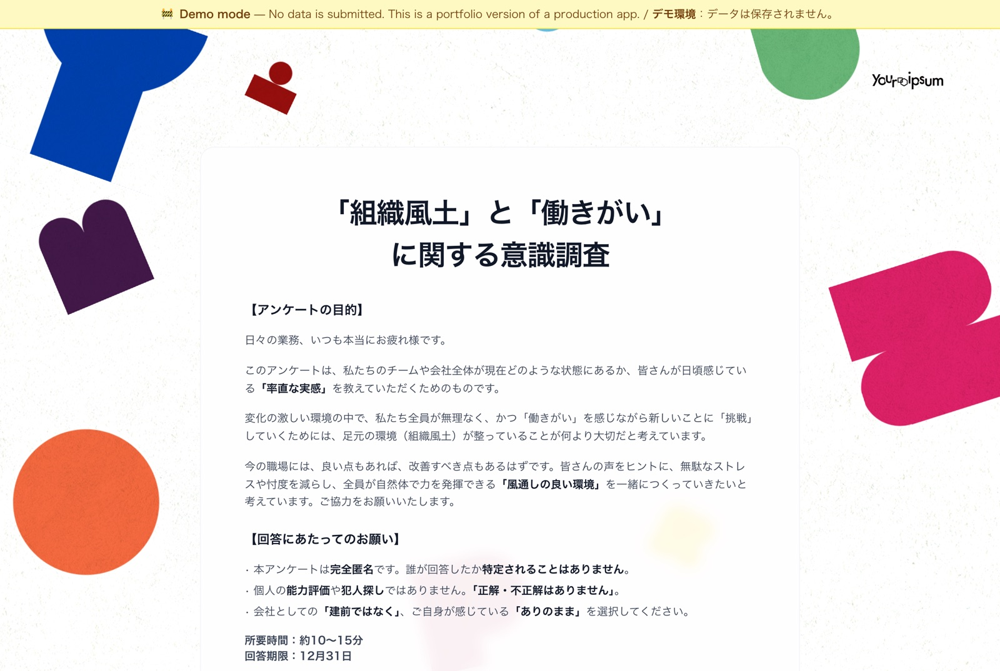
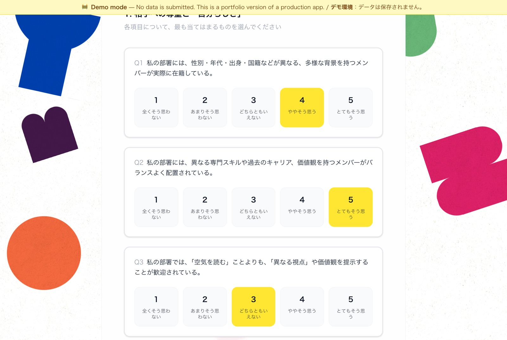
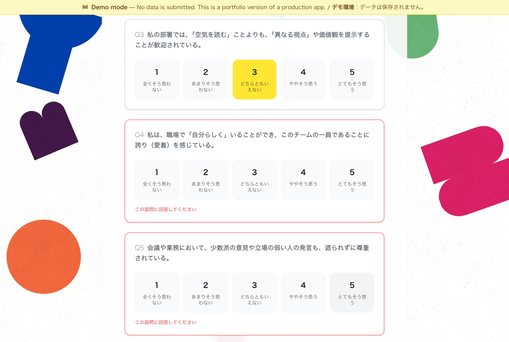
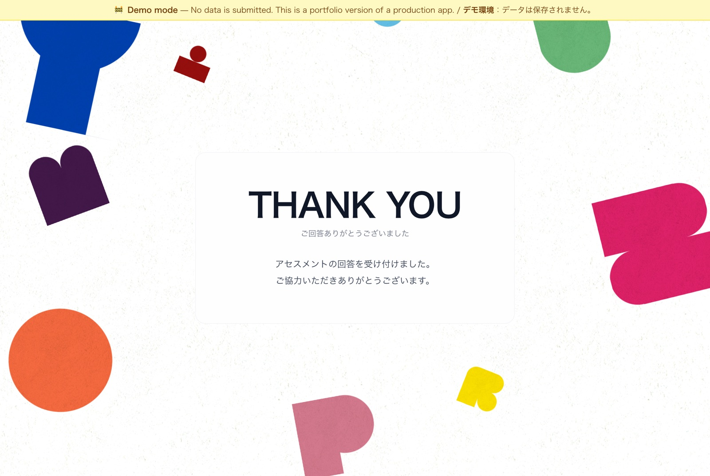
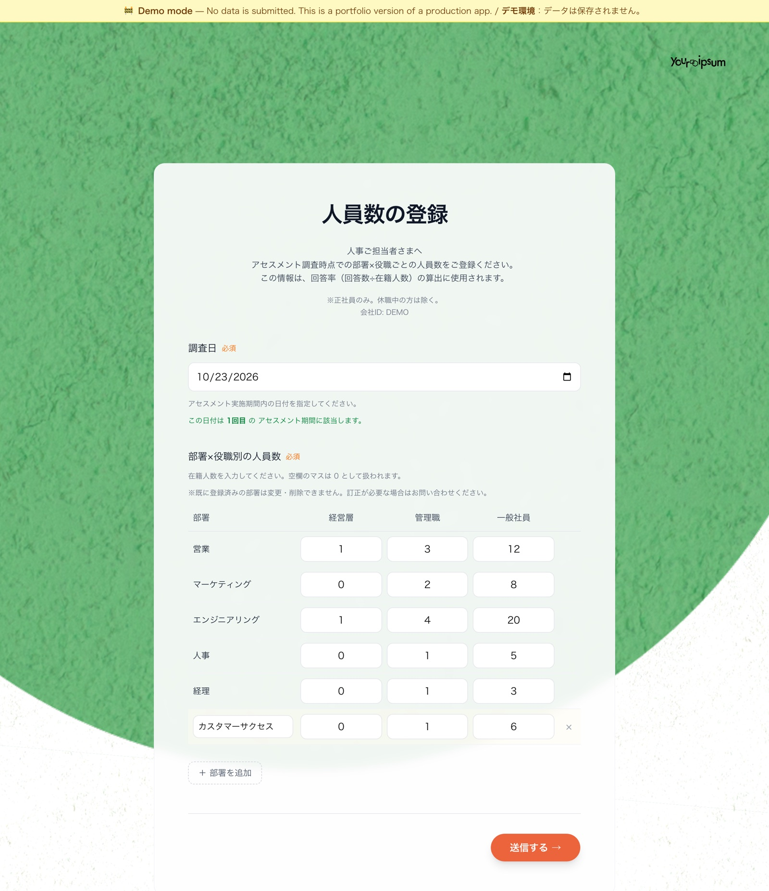
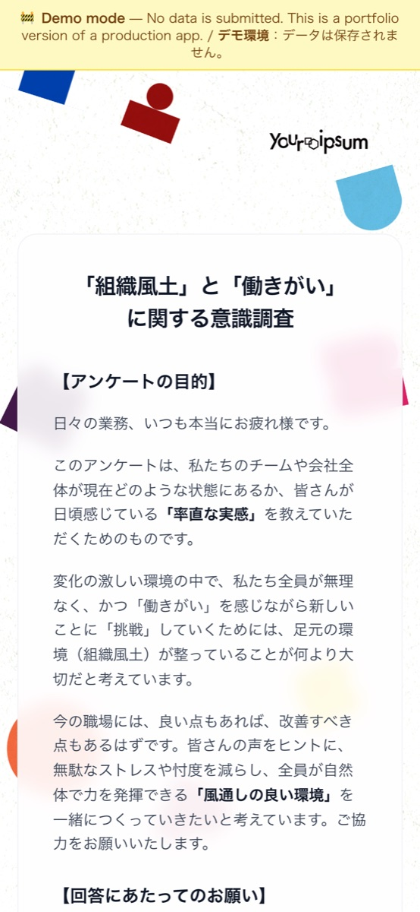

# 組織風土アセスメント

[English](./README.md) | **日本語**

コンサル会社が、支援先の企業ごとに組織風土アセスメントを実施するためのWebアプリ。社員が回答するアセスメントフォームと、人事担当者が在籍人数を登録する人事フォームの2つで構成。

**デモ**（デモ環境のため、送信してもデータは保存されません）
- アセスメントフォーム: https://interactive-contact-form-demo.vercel.app/?company=DEMO&name=Demo
- 人事フォーム: https://interactive-contact-form-demo.vercel.app/hr?company=DEMO

---

## 概要

クライアントは組織風土のコンサルティング会社で、支援先の企業ごとにアセスメントを実施している。支援先の企業はそれぞれ専用のURLとスプレッドシートを持ち、1つのアプリで複数の企業のアセスメントを扱える。

- **背景**：クライアントは元々Googleフォームでアセスメントを運用していたが、ブランディング強化のため、独自の世界観を持ったデザインのフォームへの移行が必要になった
- **目的**：クライアントのブランドアセットを活用しつつ、既存の分析基盤（Looker Studio）への連携を維持したまま、フォームを作り直す
- **開発期間**：2026年3月〜8月

---

## 技術スタック

**Frontend**
- Next.js 16（App Router）
- React 19
- TypeScript 5
- Tailwind CSS 4
- shadcn/ui
- Framer Motion

**Backend**
- Google Apps Script（サーバーレスAPI）
- Google Sheets（データストレージ）

**Infrastructure**
- Vercel（ホスティング、ブランチごとの自動デプロイ）
- カスタムサブドメイン（CNAMEレコード設定）

**Visualization**
- Looker Studio（デザインテンプレートを担当）

---

## 主な機能

**アセスメントフォーム（社員向け）**
- 7ステップの多段フォーム（属性選択＋6セクション・56問）、プログレスバー付き
- 未回答の設問をハイライトし、最初の未回答設問まで自動スクロール
- PCでは回答後に次の設問へ自動スクロール（スマホでは無効）
- 送信前の確認ダイアログ
- 送信の結果を待たずに完了画面を表示し、送信に失敗した場合は入力画面に戻してエラーを表示（待ち時間を感じさせないため）
- 会社ごとの部署リストと回答期限を動的に表示

**人事フォーム（人事担当者向け）**
- 部署×役職別の在籍人数を登録
- 既存部署の人数更新と、新規部署の追加を1画面で完結
- 調査日から「何回目のアセスメントか」（年最大4回）を自動判定し、正しい列に記録
- 部署名の重複や空欄、数値以外の入力をその場で表示
- 全角数字を自動で半角に変換

**デザイン**
- クライアントのブランドカラー9色を使ったフローティング背景アニメーション
- PC用とスマホ用で別レイアウト

---

## 担当範囲

- フロントエンド、バックエンド（GAS）、インフラ、デプロイまでを一人で担当
- クライアントとの要件定義と仕様調整
- Looker Studioのデザインテンプレート作成（データ設定はクライアント側で対応）

---

## 技術的な工夫

### 1. マルチテナント設計
URLパラメータ（`?company=xxx`）で会社を識別し、会社ごとの設定（部署リスト、調査期間）をAPIから取得。新しい会社の追加は、テンプレートのスプレッドシートを複製してIDを登録するだけで済む。

### 2. 部署管理の設計判断
部署リストの持ち方について、2つの案を比較してクライアントと決定した。
- **案A**：全社共通の固定リスト（シンプルだが、会社ごとの違いに対応できない）
- **案B**：会社ごとにスプレッドシートから動的に取得（柔軟だが、事前登録が必要）

会社ごとに部署名や部署数が違うという要件から案Bを採用。さらに、部署の登録と人数入力を同じフォームにまとめた。初回は部署を追加しながら人数を入力し、2回目以降は登録済みの部署が自動で表示されるので、事前に部署を登録する別の作業が要らない。

### 3. 既存のデータパイプラインを壊さない移行
Googleフォームから、GAS経由でスプレッドシートに直接書き込む方式に移行。既存の列構成を保ったまま書き込むことで、Looker Studio側の設定を変えずに済むようにした。人事フォーム用のAPIは `action` パラメータで分岐させ、既存のアセスメント用処理には手を加えずに追加した。

### 4. 期間に基づく自動判定
各回の開始日・終了日と調査日を照合して回を判定。アセスメントフォームでは、今日の日付から現在の回（なければ次の回）の終了日を計算し、回答期限として表示している。

### 5. React 19のルールに沿った非同期データ取得
`useEffect` の中で同期的に `setState` を呼ばない形でデータ取得を実装。キャンセルフラグを入れて、古いレスポンスがstateを上書きするのを防いでいる。

### 6. Framer Motionによるブランド表現
図形が登場するアニメーションの完了を検知してから、揺れるアニメーションに切り替える二段階の構成。図形ごとにIDから揺れ幅と周期を決めることで、ランダムに見えつつ毎回同じ動きになるようにした。

---

## 苦労と学び

### 1. 人事フォームの設計
当初は補助的なフォームの想定だったが、会社ごとに部署数・部署名が変わることが分かり、設計が大きく変わった。部署の登録と人数入力を一つのフォームにまとめ、初回は空の状態から部署を追加、2回目以降は登録済みの部署が表示される形で解決した。

### 2. データモデルの設計
「どの会社の、どの部署の、どの回の、どの役職の人数か」という4つの軸をどう持つかに時間をかけた。会社ごとに独立したスプレッドシートを持ち、その中を「縦軸＝部署、横軸＝回×役職」の表にすることで、Looker Studioとの連携もシンプルにできた。

### 3. 仕様変更への対応
開発中にクライアントの方針が何度か変わり、実装済みの部分を作り直す場面もあった。画面の表示、API呼び出し、データの整形を別のファイルに分けていたため、変更の影響を小さく抑えられた。

### 4. 描画の不具合の原因調査
回転した図形の周りに細い線が出ていた。CSSの指定では消えなかったため、表示を比べて調べたところ、SVGの中にPNGを埋め込む作りが原因だった。PNGを直接使う形に変えて解消した。

---

## スクリーンショット

| アセスメントフォーム：最初の画面 | アセスメントフォーム：設問 |
|---|---|
|  |  |
| **未回答の設問のエラー表示** | **完了画面** |
|  |  |

| 人事フォーム | スマホ表示 |
|---|---|
|  |  |

---

## アーキテクチャ

1. 社員は**アセスメントフォーム**、人事担当者は**人事フォーム**から入力する
2. 両フォームとも **Google Apps Script** のAPIにデータを送信する
3. GASは、回答を**マスタースプレッドシート**と**会社別スプレッドシート**に書き込む
4. 会社別スプレッドシートには、調査期間（`input1`）と部署×役職別の人数（`input2`）を保存する
5. **Looker Studio** が会社別スプレッドシートを読み込み、回答率などを可視化する

---

## 開発環境のセットアップ

**前提**：Node.js 20以上

```bash
git clone https://github.com/ymukaijima/interactive-contact-form.git
cd interactive-contact-form
npm install
```

プロジェクトのルートに `.env.local` を作成：

```
NEXT_PUBLIC_GAS_ENDPOINT_URL=https://script.google.com/macros/s/<YOUR_SCRIPT_ID>/exec
```

開発サーバーを起動：

```bash
npm run dev
```

`http://localhost:3000/?company=<会社ID>` で確認できます。

**GASなしで動かす場合**：`portfolio-demo` ブランチにはモックデータが入っているので、環境変数なしで動きます。

```bash
git checkout portfolio-demo
npm run dev
```

---

## ライセンス

このリポジトリのコードはポートフォリオとして公開しています。ロゴや図形などのブランド素材、設問の内容はクライアントに帰属するため、再利用はできません。
