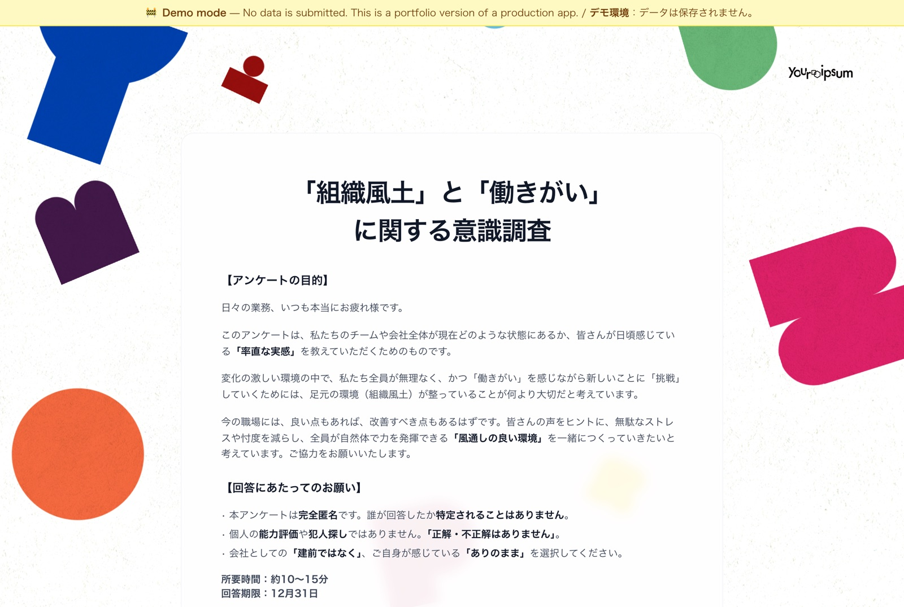
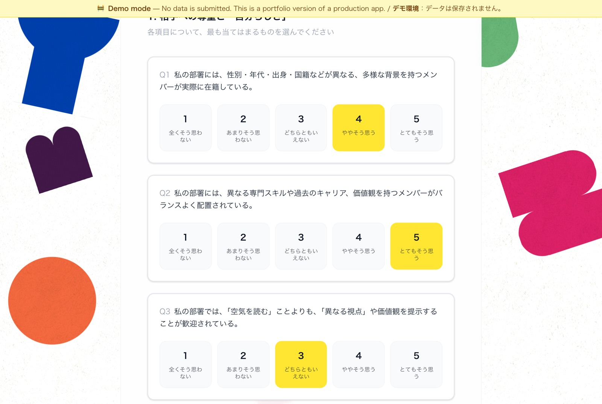
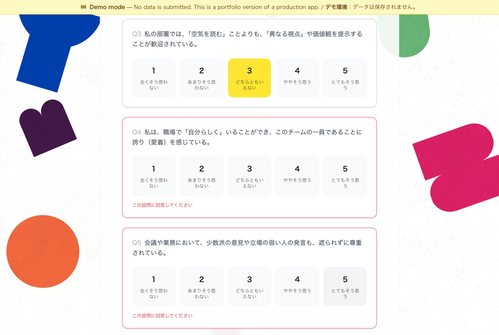
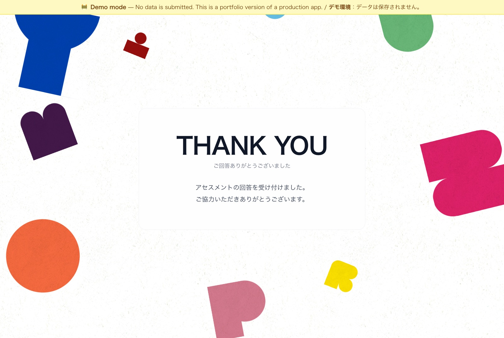
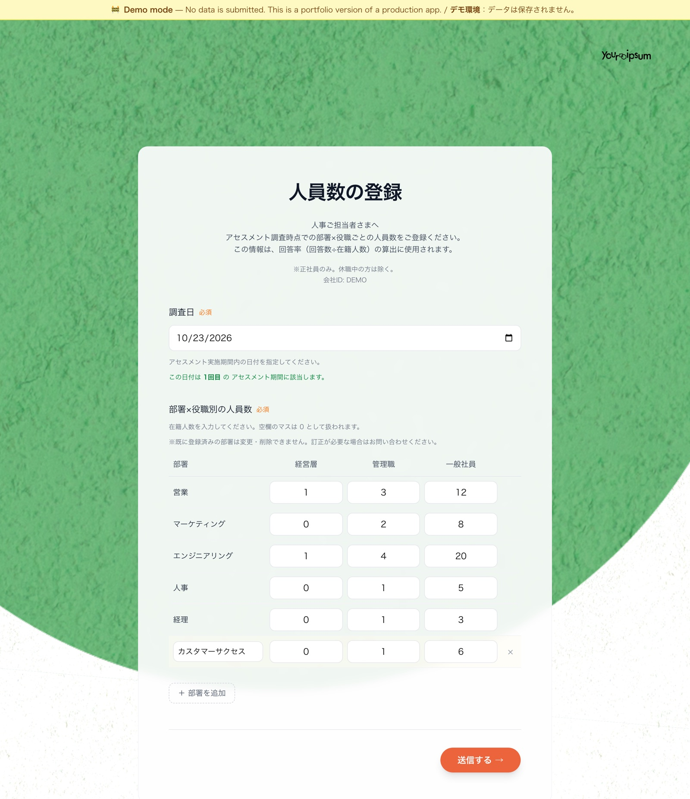
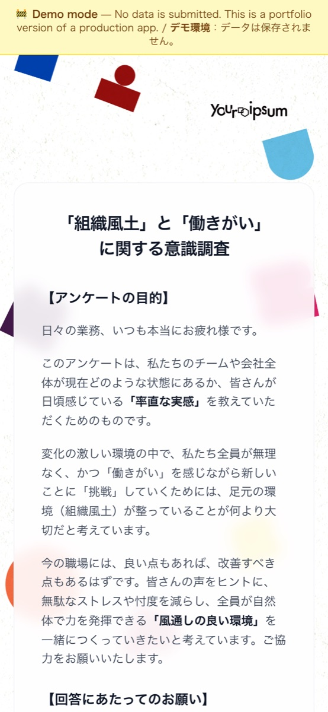

# Organization Culture Assessment Platform

**English** | [日本語](./README.ja.md)

A multi-tenant web app for running organizational culture assessments. It has two forms: an assessment form for employees, and a headcount form for HR staff.

**Live demo** (demo mode — submissions are not saved)
- Assessment form: https://interactive-contact-form-demo.vercel.app/?company=DEMO&name=Demo
- HR form: https://interactive-contact-form-demo.vercel.app/hr?company=DEMO

> The UI is in Japanese because the app was built for a Japanese client.

---

## Overview

My client is a consultancy that runs culture assessments for the companies it works with. Each of those companies gets its own URL and its own spreadsheet.

- **Background:** The client was running the assessment on Google Forms. They wanted a form that matched their brand instead of the standard Google Forms look.
- **Goal:** Rebuild the forms with the client's brand assets, without breaking the existing Looker Studio dashboards that read from the spreadsheets.
- **Timeline:** March – August 2026

---

## Tech Stack

**Frontend**
- Next.js 16 (App Router)
- React 19
- TypeScript 5
- Tailwind CSS 4
- shadcn/ui
- Framer Motion

**Backend**
- Google Apps Script (serverless API)
- Google Sheets (data storage)

**Infrastructure**
- Vercel (hosting, per-branch deployments)
- Custom subdomain via CNAME record

**Visualization**
- Looker Studio (I built the design template; the client owns the data setup)

---

## Features

**Assessment form (employees)**
- 7-step form: profile questions plus 6 sections with 56 questions, with a progress bar
- Unanswered questions are highlighted, and the page scrolls to the first one
- On desktop, the page scrolls to the next question after each answer (turned off on mobile)
- Confirmation dialog before submitting, and an optimistic success screen that rolls back if the request fails
- Department options and the response deadline are loaded per company

**HR form (HR staff)**
- Enter headcount by department and role
- Update existing departments and add new ones on the same screen
- Works out which of the (up to 4) assessment rounds the survey date belongs to, and writes the numbers to the right columns
- Inline validation for duplicate or empty department names and non-numeric input
- Converts full-width digits to half-width automatically (common with Japanese keyboards)

**Design**
- Floating background animation using the client's 9 brand colors
- Separate layouts for desktop and mobile

---

## My Role

- Sole developer: frontend, backend (GAS), infrastructure, and deployment
- Gathered requirements and worked through spec changes with the client
- Built the Looker Studio design template

---

## Technical Highlights

### 1. Multi-tenant design
The company is identified by a URL parameter (`?company=xxx`). Each company's settings — departments and survey periods — are fetched from the API. Adding a new company only needs a copy of the template spreadsheet and one line of config.

### 2. Choosing how to manage departments
I compared two options with the client:
- **Option A:** One fixed department list for every company. Simple, but can't handle companies with different structures.
- **Option B:** Load each company's departments from its own spreadsheet. Flexible, but the departments have to be registered somewhere first.

Companies had different department names and numbers, so we went with Option B. I also put department registration and headcount entry in the same form. On the first visit, HR adds departments while entering numbers. After that, the saved departments show up automatically, so there's no separate setup step.

### 3. Migrating without breaking the data pipeline
I replaced Google Forms with direct writes to the spreadsheet through GAS. The writes keep the existing column layout, so the Looker Studio dashboards didn't need any changes. The GAS endpoint checks a field in each request (`action` or `form_type`) and routes it to the right handler, so I could add the HR form without touching the existing assessment handler.

### 4. Detecting the assessment round from dates
The survey date is matched against each round's start and end dates. The assessment form uses today's date to find the current round (or the next one) and shows its end date as the deadline.

### 5. Data fetching that follows React 19's rules
Data is fetched without calling `setState` synchronously inside `useEffect`. A cancellation flag stops a stale response from overwriting newer state.

### 6. Brand animation with Framer Motion
Each shape plays an entry animation, then switches to a looping wiggle once the entry finishes. The wiggle's size and speed come from each shape's ID, so the motion looks random but stays the same on every load.

---

## Challenges & Learnings

### 1. Designing the HR form
The HR form started as a small add-on. Once we found that each company has its own set of departments, the design got much more involved. Combining department registration and headcount entry into one form solved it: the first visit starts empty, and later visits show the saved departments.

### 2. Modeling the data
The numbers depend on four things: company, department, round, and role. I gave each company its own spreadsheet, laid out as a grid with departments as rows and round × role as columns. That kept the Looker Studio connection simple.

### 3. Handling spec changes
The client's direction changed a few times during the project, and some finished parts had to be rebuilt. Because the UI, API calls, and data formatting lived in separate files, each change stayed contained.

### 4. Tracking down a rendering bug
Rotated shapes showed thin lines around their edges, and CSS tweaks didn't remove them. Comparing renders showed the cause: each SVG wrapped a PNG image. Using the PNGs directly fixed it.

---

## Screenshots

| Assessment form — intro | Assessment form — questions |
|---|---|
|  |  |
| **Validation for unanswered questions** | **Completion screen** |
|  |  |

| HR form | Mobile |
|---|---|
|  |  |

---

## Architecture

1. Employees use the **assessment form**; HR staff use the **HR form**.
2. Both forms send data to a **Google Apps Script** API.
3. GAS writes responses to a **master spreadsheet** and to each **company spreadsheet**.
4. Each company spreadsheet stores survey periods (`input1`) and headcount by department and role (`input2`).
5. **Looker Studio** reads the company spreadsheets and shows response rates and other metrics.

---

## Getting Started

**Requirements:** Node.js 20 or later

```bash
git clone https://github.com/ymukaijima/interactive-contact-form.git
cd interactive-contact-form
npm install
```

Create `.env.local` in the project root:

```
NEXT_PUBLIC_GAS_ENDPOINT_URL=https://script.google.com/macros/s/<YOUR_SCRIPT_ID>/exec
```

Start the dev server:

```bash
npm run dev
```

Open `http://localhost:3000/?company=<COMPANY_ID>`.

**Without GAS:** the `portfolio-demo` branch uses mock data and runs without any environment variables.

```bash
git checkout portfolio-demo
npm run dev
```

---

## License

The code is shared here as part of my portfolio. The logo, background shapes, and assessment questions belong to the client and may not be reused.
